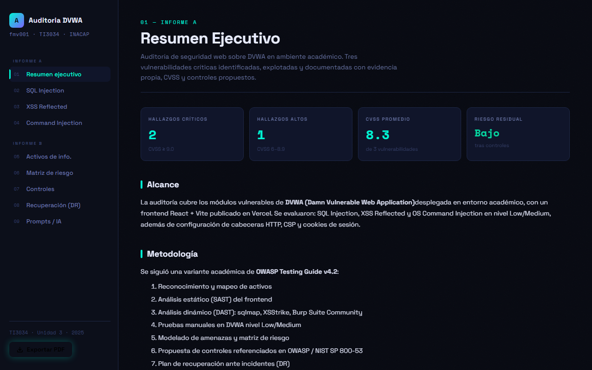

<div align="center">

# 🔐 Auditoría de Seguridad Web — DVWA

**TI3034 · Fundamentos de Seguridad de la Información · INACAP Valparaíso**

[](https://github.com/Fernandamv96/Auditoria-Fundamentos-de-la-seguridad-de-la-informaci-n-/actions/workflows/ci.yml)
[](https://auditoria-fundamentos-de-la-segurid.vercel.app/)
[](https://react.dev/)
[](https://vitejs.dev/)
[](https://owasp.org/www-project-top-ten/)

<br/>

### 🌐 [Ver presentación en vivo →](https://auditoria-fundamentos-de-la-segurid.vercel.app/)

<br/>

</div>

---



## 📋 Información del proyecto

| Campo | Detalle |
|:---|:---|
| 👩‍💻 **Estudiante** | Fernanda MV |
| 🏫 **Institución** | INACAP Valparaíso |
| 👨‍🏫 **Docente** | Rubén Schnettler |
| 📚 **Asignatura** | TI3034 — Fundamentos de Seguridad de la Información |
| 🎯 **Entorno auditado** | DVWA — Damn Vulnerable Web Application |
| ⚖️ **Ponderación** | 60% nota final (30% Entrega A + 30% Entrega B) |

---

## 🚨 Hallazgos principales

| ID | Vulnerabilidad | CVSS | Severidad | Activo afectado |
|:---:|:---|:---:|:---:|:---|
| H-01 | SQL Injection | **9.1** | 🔴 Crítico | BD DVWA |
| H-02 | Command Injection | **9.8** | 🔴 Crítico | Servidor App |
| H-03 | XSS Reflected | **6.1** | 🟠 Alto | Navegador / Sesión |
| H-04 | Falta de CSP | 5.4 | 🟡 Medio | Frontend React |
| H-05 | Cookies sin HttpOnly | 5.3 | 🟡 Medio | Cookies sesión |

---

## 📑 Contenido del informe

| # | Sección | Rúbrica |
|:---:|:---|:---:|
| 01 | [Resumen ejecutivo](https://auditoria-fundamentos-de-la-segurid.vercel.app/resumen) | A |
| 02 | [SQL Injection — CVSS 9.1](https://auditoria-fundamentos-de-la-segurid.vercel.app/sqli) | 3.1.1 |
| 03 | [XSS Reflected — CVSS 6.1](https://auditoria-fundamentos-de-la-segurid.vercel.app/xss) | 3.1.1 |
| 04 | [Command Injection — CVSS 9.8](https://auditoria-fundamentos-de-la-segurid.vercel.app/comandos) | 3.1.1 |
| 05 | [Inventario de activos](https://auditoria-fundamentos-de-la-segurid.vercel.app/activos) | 3.1.2 |
| 06 | [Matriz de riesgo 5×5](https://auditoria-fundamentos-de-la-segurid.vercel.app/matriz) | 3.1.3 |
| 07 | [Controles OWASP + NIST](https://auditoria-fundamentos-de-la-segurid.vercel.app/controles) | 3.1.4 + 3.1.5 |
| 08 | [Recuperación ante desastres](https://auditoria-fundamentos-de-la-segurid.vercel.app/recuperacion) | 3.1.6 |
| 09 | [Prompts y uso de IA](https://auditoria-fundamentos-de-la-segurid.vercel.app/prompts) | Transversal |

---

## 🛠️ Stack tecnológico

```
Frontend    →  React 18 + Vite 5
Deploy      →  Vercel (CI/CD automático desde GitHub)
PDF Export  →  html2canvas + jsPDF
Auditoría   →  DVWA (PHP + MySQL)
```

---

## 📐 Marcos normativos aplicados

- **OWASP Top 10 (2021)** — A03 Injection · A05 Security Misconfiguration · A09 Logging
- **NIST SP 800-53 Rev. 5** — SI-10 · SC-8 · SC-28 · CM-7 · AU-2
- **NIST SP 800-61 Rev. 2** — Plan de respuesta a incidentes
- **CWE** — CWE-89 · CWE-79 · CWE-78 · CWE-1004 · CWE-307
- **Ley 19.628** — Protección de la Vida Privada (Chile)

---

## 📁 Estructura del proyecto

```
📦 auditoria_v2/
├── 📂 src/
│   ├── 📂 components/
│   │   ├── Resumen.jsx          ← Resumen ejecutivo
│   │   ├── InyeccionSQL.jsx     ← SQL Injection (H-01)
│   │   ├── XSS.jsx              ← XSS Reflected (H-03)
│   │   ├── Comandos.jsx         ← Command Injection (H-02)
│   │   ├── Activos.jsx          ← Inventario activos (3.1.2)
│   │   ├── Matriz.jsx           ← Matriz de riesgo (3.1.3)
│   │   ├── Controles.jsx        ← Controles OWASP/NIST (3.1.4+3.1.5)
│   │   ├── Recuperacion.jsx     ← Plan DR (3.1.6)
│   │   ├── Prompts.jsx          ← Bitácora IA
│   │   └── ExportPDF.jsx        ← Exportar a PDF
│   ├── App.jsx
│   ├── main.jsx
│   └── styles.css
├── 📄 INFORME_AUDITORIA_fmv001.md
├── vercel.json
└── package.json
```

---

## ⚡ Ejecutar localmente

```bash
# Clonar el repositorio
git clone https://github.com/Fernandamv96/Auditoria-Fundamentos-de-la-seguridad-de-la-informaci-n-

# Instalar dependencias
npm install

# Levantar en desarrollo
npm run dev

# Build de producción
npm run build
```

## 🔒 Calidad y seguridad

- CI en cada push y PR: ESLint + build de Vite.
- CodeQL (análisis estático), Dependabot (npm y Actions) y gitleaks en pre-commit.
- Para reportar vulnerabilidades, mira [SECURITY.md](SECURITY.md).

## 💡 Qué aprendí

- A seguir una metodología (OWASP Testing Guide) en lugar de "probar cosas": reconocimiento, explotación, evidencia y controles.
- A puntuar hallazgos con CVSS y a priorizarlos en una matriz de riesgo.
- A explotar SQLi, XSS y Command Injection en un laboratorio controlado (DVWA), y a proponer controles OWASP/NIST concretos para cada uno.
- A convertir un informe técnico en un sitio navegable y exportable a PDF.

## 📄 Licencia

[MIT](LICENSE) © 2026 Fernanda (Fernandamv96)

---

<div align="center">

**INACAP Valparaíso · Unidad 3 · 2025**

[](https://auditoria-fundamentos-de-la-segurid.vercel.app/)

</div>
